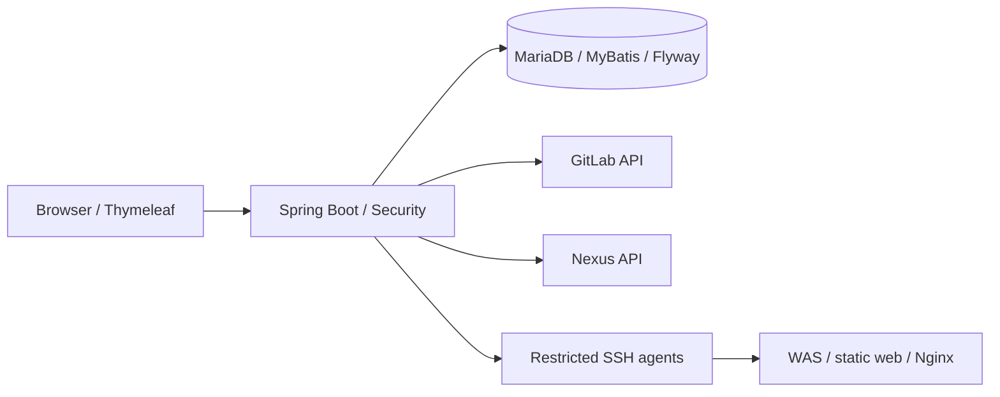

# DeployOps

배포 요청부터 승인, 실행, 상태 확인과 복구까지 연결하는 Java 서버 포트폴리오입니다. This source edition demonstrates an approval-driven deployment workflow with explicit permissions and audit records.

[포트폴리오](https://beom.it/ko#projects) · [Portfolio in English](https://beom.it/en#projects) · [공개 데모](https://deploy.beom.it)

## 주요 기능 / Features

- 환경별 배포 요청, 승인 정책, 실행 이력과 감사 기록
- GitLab 프로젝트·파이프라인·병합 요청과 CI 설정 연동
- Nexus 저장소, 아티팩트·이미지 이력, 백업·복원 작업 관리
- Nginx 정책 검토·적용·되돌리기, WAS·정적 웹 배포 에이전트
- 단계별 실행 계획, 롤링 배포, 실패 복구와 재시도 정책
- 역할·프로젝트별 권한, OTP, 선택적 WorkHub SSO



## 빌드와 테스트 / Build and test

JDK 21과 올바른 `JAVA_HOME`이 필요합니다. Maven Wrapper가 빌드 도구를 준비합니다. Java 테스트 중 JavaScript 검증과 별도 브라우저 로직 테스트에는 Node.js 22 이상이 필요하며, 셸 계약 검증에는 Bash가 필요합니다. Windows에서는 Git for Windows의 Bash를 사용할 수 있습니다.

```powershell
.\mvnw.cmd -B -ntp package
node --test src/test/js/*.test.cjs
```

Linux에서는 `sh ./mvnw -B -ntp package`로 실행합니다. 빌드 결과는 `target`에 생성됩니다. 테스트는 가짜 저장소·로컬 HTTP 서버를 사용하며 운영 서버가 필요하지 않습니다.

## 외부 설정 / External configuration

환경 파일, YAML, 연결 설정과 비밀번호 예제는 제공하지 않습니다. 실행 환경의 비밀 저장소 또는 외부 Spring 설정을 사용하세요. 설정 이름만 아래에 안내합니다.

| 목적 | 설정 이름 |
| --- | --- |
| 전용 DB | `spring.datasource.url`, `spring.datasource.username`, `spring.datasource.password` |
| 최초 관리자 | `app.bootstrap.admin-password`, `BOOTSTRAP_ADMIN_PASSWORD` |
| 샘플 생성 선택 | `app.bootstrap.sample-data-enabled`, `BOOTSTRAP_SAMPLE_DATA_ENABLED` |
| 비밀값 암호화 | `app.crypto.secret-key`, `app.crypto.key-id`, `app.crypto.previous-keys` |
| 암호화 환경변수 별칭 | `SECRET_ENCRYPTION_KEY`, `SECRET_ENCRYPTION_KEY_ID`, `SECRET_PREVIOUS_KEYS` |
| 선택적 SSO | `app.sso.shared-secret`, `SSO_SHARED_SECRET`, `app.sso.base-url` |
| 선택적 WorkHub 알림 | `app.office.base-url` |
| 업로드·백업 작업 | `app.nginx.upload-dir`, `deploy.nexus.upload-dir`, `deployops.nexus-backup.queue-root` |
| 공개 데모 선택 | `app.public-demo.enabled`, `PORTFOLIO_DEMO_USERNAME`, `PORTFOLIO_DEMO_PASSWORD` |

공개 데모 모드는 전용 데모 DB 이름과 외부 계정을 마이그레이션 전에 확인합니다. 설정한 데모 자격정보는 데모 화면에 공개되며 파괴적 작업과 외부 연동은 제한됩니다. 일반 관리자 자격정보와 분리해서 사용해야 합니다. 고정 비밀번호는 소스에 들어 있지 않습니다.

이 공개본의 초기화와 마이그레이션은 별도로 준비한 개발 DB를 대상으로 합니다. 기존 설치에 적용하는 업그레이드 묶음이 아닙니다. 자동 Flyway checksum 복구는 기본적으로 실행하지 않습니다.

## 설치·유지보수 소스

`installer`는 역할별 설치와 제한된 배포 에이전트, 백업·복원·패치 구현을 설명하는 소스입니다. Maven은 유지보수 리소스를 애플리케이션에 포함합니다. 오프라인 배포용 JAR·이미지·릴리스 잠금 파일·환경별 설정은 이 저장소에 포함하지 않으므로 clone만으로 완성된 오프라인 설치 묶음이 만들어지지는 않습니다.

선택적 `embedded-config` Maven 프로필은 운영자가 외부에서 준비한 비공개 설정을 읽습니다. 공개 빌드에는 해당 파일이 없습니다. 일반 실행은 설정이 없는 경우에도 임의의 연결 정보나 비밀값을 만들지 않습니다.

## 출처와 라이선스

프로젝트 소스에 대한 새로운 포괄적 사용 허락은 이 저장소에서 부여하지 않습니다. 포함한 서드파티 리소스의 고지와 라이선스는 [THIRD_PARTY_NOTICES.md](THIRD_PARTY_NOTICES.md)에 보존합니다.
